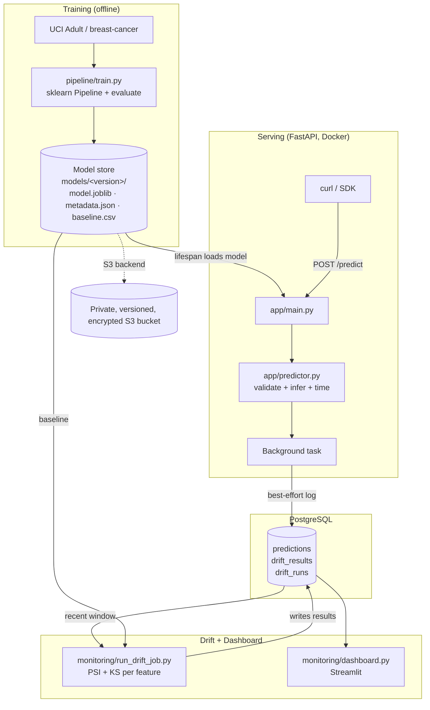

# ml-serving-drift-platform

A single, portfolio-grade system that combines **production-style ML model
serving on AWS** with a **model monitoring and data-drift dashboard**. A
scikit-learn classifier (UCI Adult Income) is served through a FastAPI REST API
in Docker, every prediction is logged to PostgreSQL, a background job computes
per-feature **PSI** and **two-sample KS** drift statistics against the training
baseline, and a Streamlit dashboard visualises traffic, latency and drift alerts
in near real time. The whole stack runs locally with one
`docker compose up --build` command and deploys to AWS EC2 with the versioned
model stored in a private S3 bucket.

> Every number in the **Results** section below is produced by the scripts in
> this repository (`pipeline/train.py`, `scripts/measure_metrics.py`) and pasted
> from real output. See [`docs/results.md`](docs/results.md). Anything not run
> in this environment is labelled **not yet measured**.

> 📖 Looking for the *why*? [`docs/FEATURES.md`](docs/FEATURES.md) documents
> every feature, the full tech stack, and the design rationale behind each choice.
> For a technology-by-technology breakdown see
> [`docs/TECH_STACK.md`](docs/TECH_STACK.md).

---

## Table of contents

- [Architecture](#architecture)
- [Tech stack](#tech-stack)
- [Features, tech stack & why (design doc)](docs/FEATURES.md)
- [Tech stack deep-dive & rationale](docs/TECH_STACK.md)
- [Quick start (3 commands)](#quick-start-3-commands)
- [API reference and curl examples](#api-reference-and-curl-examples)
- [Training](#training)
- [Traffic simulation and the drift job](#traffic-simulation-and-the-drift-job)
- [Dashboard](#dashboard)
- [AWS deployment](#aws-deployment)
- [Testing and CI](#testing-and-ci)
- [Results (measured)](#results-measured)
- [Limitations and future work](#limitations-and-future-work)
- [Acknowledgements / references](#acknowledgements--references)

---

## Architecture



**Flow:** train once → serve the pinned/latest version → log every prediction
(asynchronously, so logging can never slow or break a response) → periodically
compare recent traffic to the stored training baseline → surface drift in the
dashboard with an alert banner.

---

## Tech stack

| Area | Technology |
|---|---|
| Language / runtime | Python 3.11 |
| ML | scikit-learn, pandas, NumPy, SciPy, joblib |
| Model | `RandomForestClassifier` in a sklearn `Pipeline` (imputers + scaler + one-hot) |
| API | FastAPI, Pydantic v2, Uvicorn |
| Database | PostgreSQL 16, SQLAlchemy 2.0, psycopg2 |
| Storage / cloud | AWS S3 (model artifacts), AWS EC2 (compute), boto3 |
| Monitoring | PSI + two-sample KS test, Streamlit, Plotly |
| Testing | pytest, httpx, moto (S3 mock), coverage |
| Quality | Ruff (lint + format) |
| Containerization | Docker (multi-stage, non-root), Docker Compose |
| CI/CD | GitHub Actions |

> For a technology-by-technology breakdown (what each tool is, where it is used,
> and why it was chosen over the alternatives), see
> [`docs/TECH_STACK.md`](docs/TECH_STACK.md).

---

## Quick start (3 commands)

```bash
# 1. Copy example env (defaults run the whole stack locally with no AWS account)
cp .env.example .env

# 2. Start API + PostgreSQL + dashboard. On first boot the container trains an
#    offline breast-cancer demo model so the API is ready with zero manual steps.
docker compose up --build

# 3. Verify the model is loaded and serving
curl http://localhost:8000/health
```

Then open the dashboard at <http://localhost:8501>.

> To serve the **UCI Adult** model this repo's results were measured on: run
> `DEMO_DATASET=adult docker compose up --build`, or train locally with
> `make train` (see below) and mount the `models/` directory.

### Running without Docker (local dev)

```bash
make install      # create .venv and install requirements-dev.txt
make train-fast   # offline model on breast-cancer (or: make train for Adult)
make serve        # uvicorn on :8000
make test         # pytest with coverage
make lint         # ruff check
```

---

## API reference and curl examples

| Method | Path | Purpose |
|---|---|---|
| `POST` | `/predict` | One record → label, probability, model version, latency (ms) |
| `POST` | `/predict/batch` | Up to 1,000 records at once (exceeding the limit → `413`) |
| `GET` | `/health` | Liveness + `model_loaded`, `model_version`, `dataset` |
| `GET` | `/ready` | `200` when a model is loaded, else `503` |
| `GET` | `/model` | Full metadata + training metrics for the loaded version |
| `POST` | `/reload` | Hot-swap to the latest (or pinned) model without restarting |

Invalid or incomplete records return structured **`422`** errors (missing fields,
non-numeric values, unexpected features) — never a `500`.

```bash
# Single prediction (UCI Adult features)
curl -X POST http://localhost:8000/predict \
  -H "Content-Type: application/json" \
  -d '{"features":{
        "age":42,"workclass":"Private","fnlwgt":180000,"education":"Some-college",
        "education-num":9,"marital-status":"Married-civ-spouse","occupation":"Sales",
        "relationship":"Husband","race":"White","sex":"Male","capital-gain":0,
        "capital-loss":0,"hours-per-week":45,"native-country":"United-States"}}'
```

```json
{
  "prediction": ">50K",
  "probability": 0.67,
  "model_version": "20261029T105411Z",
  "latency_ms": 3.2
}
```

```bash
# Batch
curl -X POST http://localhost:8000/predict/batch \
  -H "Content-Type: application/json" \
  -d '{"records":[{"age":42,"workclass":"Private","fnlwgt":180000,"education":"Some-college","education-num":9,"marital-status":"Married-civ-spouse","occupation":"Sales","relationship":"Husband","race":"White","sex":"Male","capital-gain":0,"capital-loss":0,"hours-per-week":45,"native-country":"United-States"}]}'

# Structured validation error (missing required features)
curl -s -X POST http://localhost:8000/predict \
  -H "Content-Type: application/json" -d '{"features":{"age":30}}'
# -> HTTP 422 with a list of {"loc","msg","type":"missing_field"} entries
```

---

## Training

```bash
make train          # UCI Adult Income via fetch_openml("adult", version=2)
make train-fast     # offline breast-cancer (used by CI and the demo image)
python -m pipeline.train --dataset adult --model gradient_boosting --rows 5000
```

Each run writes a **versioned** artifact to `models/<UTC-timestamp>/`:

- `model.joblib` – the fitted sklearn `Pipeline`
- `metadata.json` – feature order, class labels, metrics, library versions, training row count, creation time
- `baseline.csv` – a held-out per-feature training sample used as the drift reference

Switch the backend with `MODEL_STORE=s3` to save/load the same layout in S3, and
roll back at any time by pinning `MODEL_VERSION`.

---

## Traffic simulation and the drift job

```bash
# Send normal traffic, then a deliberately shifted stream (numeric features
# multiplied by 1.4 and nudged by +0.5 std) so drift can be demonstrated.
python scripts/simulate_traffic.py --normal 500 --shifted 500

# Compare the most recent 1000 logged predictions to the training baseline and
# write per-feature results + a run summary back to PostgreSQL.
python -m monitoring.run_drift_job --window 1000
# or via the compose "jobs" profile:
docker compose --profile jobs run --rm drift-job
```

**Drift rule** (`monitoring/drift.py`): a numeric feature is *drifted* when its
**PSI > 0.2** (10 quantile bins taken from the baseline) **and** the two-sample
**KS p-value < 0.05**. Categorical features use PSI on category frequencies.
**Overall drift** fires when **more than 20%** of monitored features drift
(all thresholds are configurable via environment).

---

## Dashboard

`monitoring/dashboard.py` (Streamlit, reads directly from PostgreSQL):

- **Overview** – request volume over time, total requests, current model version(s)
- **Latency** – p50/p95 for the window, median latency over time
- **Drift** – per-feature PSI bars with the 0.1 / 0.2 thresholds marked, KS p-values, and drift history across runs
- **Recent predictions** – the latest logged records
- **Alerts** – a red banner whenever the most recent drift run reports overall drift

A sidebar slider filters the whole dashboard by time window.

```bash
docker compose up -d            # dashboard already running on :8501
# or locally:
streamlit run monitoring/dashboard.py
```

---

## AWS deployment

Full walkthrough in [`infra/deploy_ec2.md`](infra/deploy_ec2.md). Summary:

1. Create a **private, versioned, encrypted** S3 bucket (public access blocked).
2. Attach an **IAM role** to EC2 with the least-privilege policy in
   [`infra/s3_policy.json`](infra/s3_policy.json) (`ListBucket` + `GetObject`/`PutObject`
   scoped to `models/*`). **No AWS keys are ever stored in code or `.env`.**
3. Train with `MODEL_STORE=s3` to upload the versioned artifact.
4. Launch EC2 (Docker installed), clone the repo, set `.env`, run
   `docker compose up -d --build`. The API downloads the model from S3 at startup.
5. Open only ports 22 / 8000 / 8501 in the security group (never 5432), then verify with `curl`.

---

## Testing and CI

```bash
make test         # pytest -q --cov
make lint         # ruff check .
```

The suite covers the endpoint contract and validation errors, health/readiness,
reload/rollback, preprocessing/training/evaluation, the KS/PSI math on known
distributions, the S3 backend via **moto**, the end-to-end drift job, and
database-logging failure tolerance.

- **Tests: 44** (all passing), **coverage: 92%** (measured locally with
  `pytest --cov`; see [Results](#results-measured)).
- CI is defined in [`.github/workflows/ci.yml`](.github/workflows/ci.yml) —
  on every push/PR it runs `ruff check`, `pytest --cov`, and builds both Docker
  images. A manual [`deploy.yml`](.github/workflows/deploy.yml) SSHes to EC2 and
  redeploys. Tests run fully **offline** (breast-cancer fixture), so CI needs no
  network or AWS credentials.

> The CI workflow ships with the repo but has not been executed on GitHub from
> this environment; push to your own repository to see it run.

---

## Results (measured)

These numbers are copied verbatim from [`docs/results.md`](docs/results.md),
generated by `scripts/measure_metrics.py` against the UCI Adult model.

### Model quality (held-out stratified 20%)

| Metric | Value |
|---|---|
| Accuracy | **0.8572** |
| Macro F1 | **0.7926** |
| ROC-AUC (>50K) | **0.9057** |
| Training rows | **39,073** |

### Serving latency (local uvicorn, `DB_ENABLED=0`, 200 requests)

| Percentile | Value |
|---|---|
| p50 | **73.1 ms** |
| p95 | **97.5 ms** |

> Latency is round-trip wall-clock including HTTP overhead on a developer laptop
> with a 200-tree RandomForest. In-container inference time (timed inside
> `/predict`, returned as `latency_ms`) is typically a few ms per record.
> Logged-request count: **not yet measured** (database logging was disabled for
> the offline latency run).

### Drift detection (against the stored training baseline)

| Scenario | Features drifted | Features monitored | Overall drift |
|---|---|---|---|
| No shift (baseline resampled) | **0** | 14 | **False** |
| All numeric features shifted | **4 of 6 numeric** | 14 | **True** |

`simulate_traffic.py`-style shift (×1.4 + 0.5 std) flagged
`age, fnlwgt, education-num, hours-per-week` with PSI values 2.67–6.21, while
re-sampling the baseline produced **zero false alarms**. `capital-gain` and
`capital-loss` stayed at PSI ≈ 0 because they are zero-inflated in the Adult
training sample (their shifted values remain inside the baseline's outer bins).

---

## Dataset and licence

- **UCI Adult Income** (default) — `sklearn.datasets.fetch_openml("adult", version=2)`.
  The Census Income database, Barbarosos & Lichman (UCI, 1996), provided under
  the **CC BY 4.0** licence. https://archive.ics.uci.edu/dataset/2/adult
- **scikit-learn breast-cancer** — the bundled `load_breast_cancer()` dataset, used
  for offline CI tests and the no-manual-steps demo image.

---

## Limitations and future work

- **Drift is not auto-scheduled.** The job is one-off / on-demand; production use
  would add a scheduler (cron, EventBridge, or an Airflow DAG).
- **No feedback loop.** Predictions are logged, but ground-truth labels and model
  retraining-on-drift / shadow deployment are out of scope.
- **Latency numbers are dev-machine, not load-tested** — no concurrency benchmark
  or `locust`/`k6` harness yet.
- **Single-instance EC2** — a production setup would front the API with a load
  balancer, run the DB on RDS, and manage the model lifecycle via SageMaker or a
  registry.
- **Adversarial / multivariate drift** (beyond per-feature PSI/KS) and concept
  drift are not detected.

---
